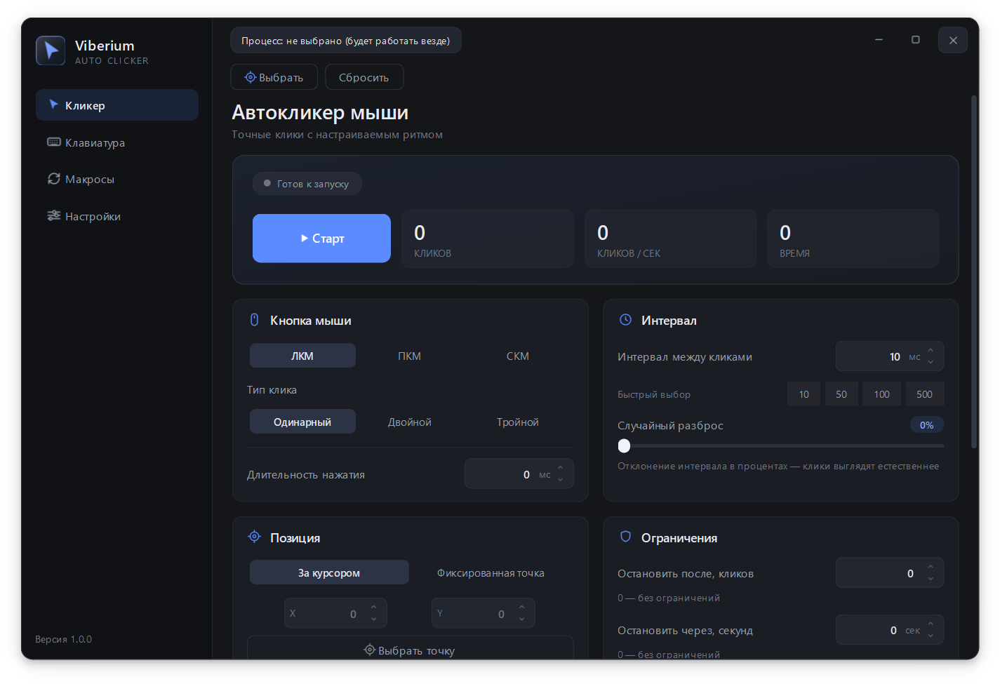
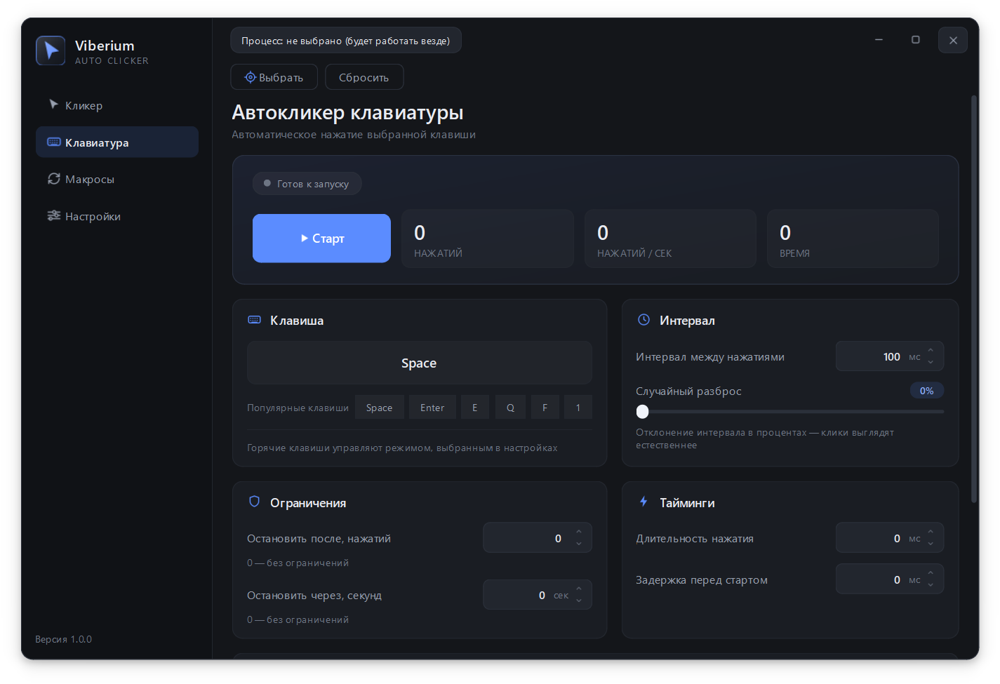
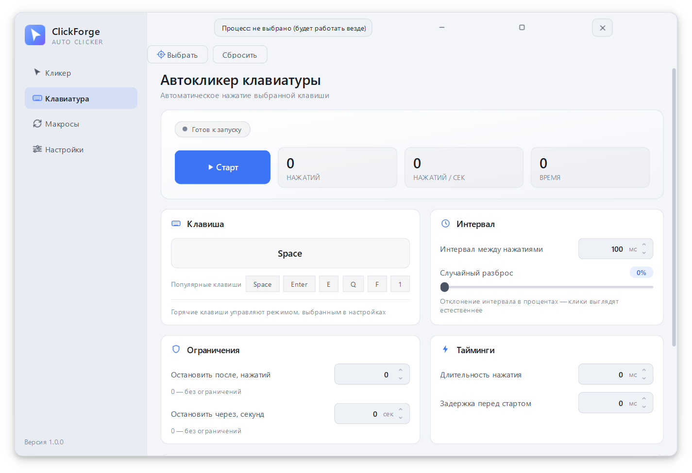
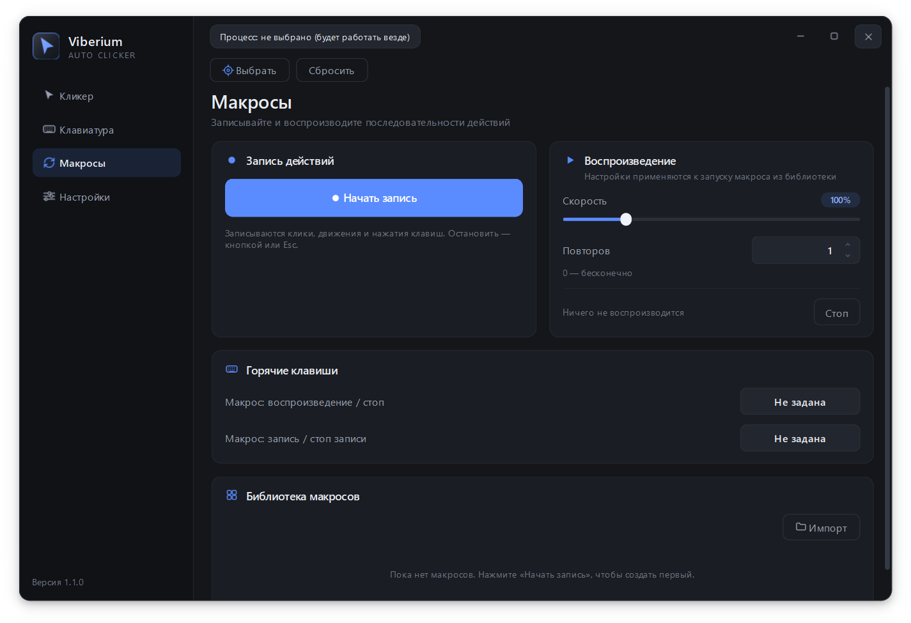
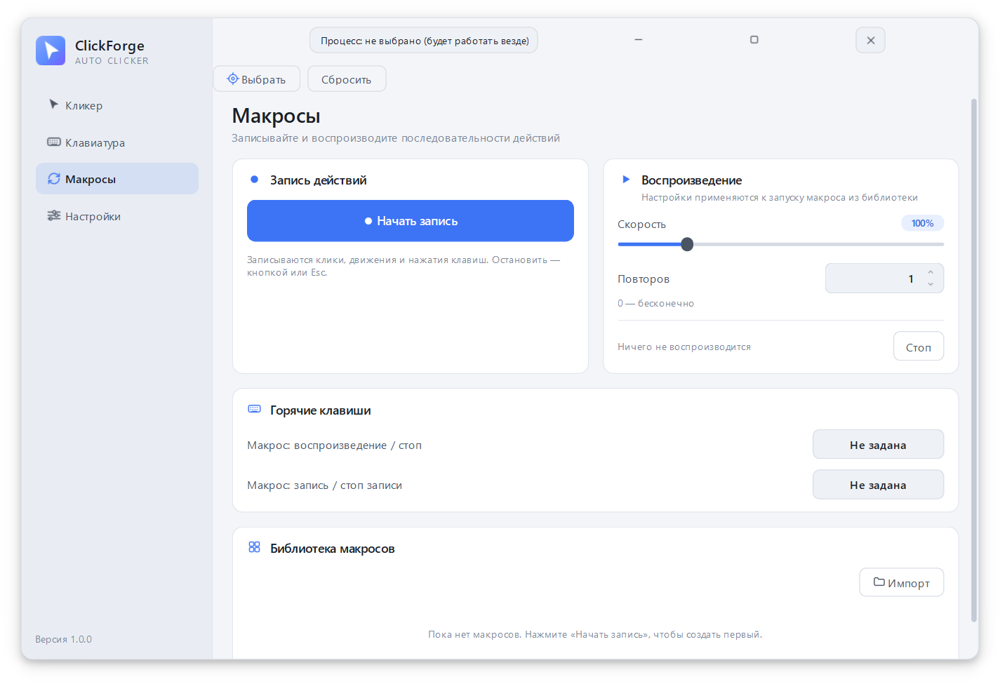
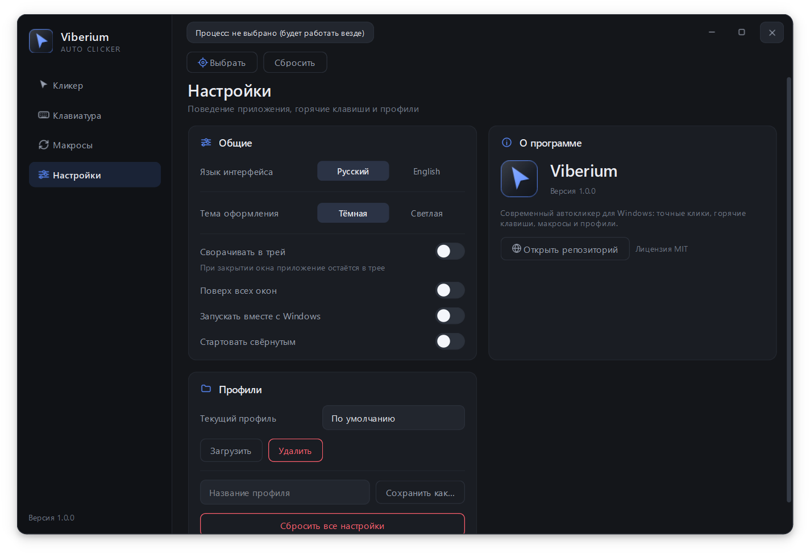
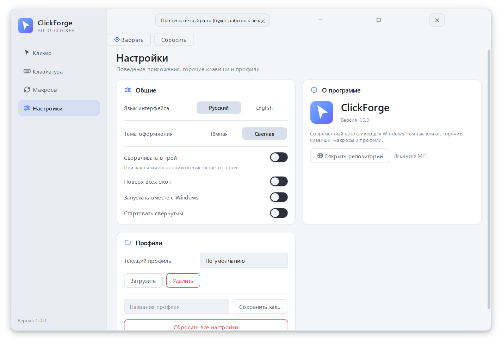

# Viberium

**A modern Windows auto clicker: fine-grained tuning, macros, hotkeys and two themes.**

[Download](#download) · [What's new](#whats-new-in-110) · [Features](#features) · [Screenshots](#screenshots) · [Website](https://mmeell65.github.io/Viberium-Autoclicker/) · [Telegram](#telegram) · [Русский](README.md)

---

## What's new in 1.1.0

- **Keyboard auto clicker**: several keys and combinations at once, "Simultaneous" and "Sequential" press modes with a pause between presses.
- **Combination capture** with Ctrl, Shift, Alt and Win — left and right modifiers are recognised correctly.
- **Reorder keys** with the arrow buttons and remove rows you don't need.
- **Project website**: [mmeell65.github.io/Viberium-Autoclicker](https://mmeell65.github.io/Viberium-Autoclicker/) — overview, screenshots and FAQ.
- **Telegram channel** linked right inside the app.

[Full changelog](CHANGELOG.md) · [Download 1.1.0](../../releases/latest)

## Windows auto clicker

Viberium is a Windows auto clicker with a fully custom interface. It works with system input directly, so clicks and key presses are precise and smooth — no browser delays or extra layers in between.

It has everything you need for routine actions: a mouse clicker, a keyboard clicker, macro recording, global hotkeys and a target-window mode. The interface is available in Russian and English, with dark and light themes.

## Telegram

News, updates and tips about Viberium — in the Telegram channel **[@viberium_autoclicker](https://t.me/viberium_autoclicker)**.

It is meant for **your own tasks on your own devices**: repetitive clicking, UI testing, automating routine actions in desktop apps. Please don't use it to break the rules of games or services.

## Features

<table>
<tr>
<td width="50%" valign="top">

### 🖱️ Mouse auto clicker
- Buttons: **left / right / middle**
- Single, double, triple clicks
- Interval in milliseconds + presets
- Random interval jitter (0–100 %)
- Hold duration
- Cursor or fixed screen position
- Position jitter
- Click and time limits
- Stop on mouse movement
- Start delay

### ⌨️ Keyboard auto clicker
- Several keys and combinations at once
- Simultaneous or sequential press modes
- Capture combinations with Ctrl, Shift, Alt, Win
- Reorder keys and set a delay between them
- Interval, jitter, hold duration
- Limits and start delay

</td>
<td width="50%" valign="top">

### 🎬 Macros
- Record clicks, cursor movement and keys
- Playback with custom speed
- Repeats and a macro library
- JSON import / export

### ⌨️🔥 Hotkeys
- Separate bindings for mouse, keyboard and macros
- Toggle and hold-to-run
- Emergency stop — **F8**
- Ctrl, Alt, Shift, Win combinations
- Mouse side buttons **X1 / X2**
- Reset a binding with **×**

### 🪟 Target window
- Run only inside a selected window
- Pauses when that window is inactive
- Works everywhere when nothing is selected
- The process is never stored in profiles

### 🎨 Interface
- Dark and light themes
- Live stats: clicks, CPS, uptime
- Tray, always on top, autostart
- Russian and English
- Settings profiles

</td>
</tr>
</table>

## Screenshots

| Dark theme | Light theme |
|:---:|:---:|
|  |  |
|  |  |
|  |  |

## Download

Grab the latest build from **[Releases](../../releases)**.

**Direct link to the latest build:**
[`Viberium-windows.zip`](../../releases/latest/download/Viberium-windows.zip) · [release page](../../releases/latest) · [project website](https://mmeell65.github.io/Viberium-Autoclicker/)

1. Download `Viberium-windows.zip`.
2. Extract the **whole** archive into any folder.
3. Run `Viberium.exe`.

> **Important:** `Viberium.exe` and the `_internal` folder must stay together. Don't pull the `.exe` out of the archive on its own — the app won't start.

No installation needed. Settings live in `%APPDATA%\Viberium`.

> **SmartScreen.** Windows may warn about an unknown publisher on first launch — that's normal for unsigned apps. Click "More info" → "Run anyway". Antivirus software may react to global input hooks.

## Requirements

| | |
|---|---|
| OS | Windows 10 / 11 (64-bit) |
| Free disk space | about 100 MB |
| Additional software | not required |

## Hotkeys

Only the emergency stop is bound by default — **F8**. Everything else is up to you on the "Clicker", "Keyboard" and "Macros" pages.

- Bindings are global, even when the window is minimized to tray.
- Ctrl, Alt, Shift, Win and mouse side buttons X1/X2 are supported.
- Clicking a capture field again cancels recording and clears the binding; the **×** button does the same.

## Where to find Viberium

| | |
|---|---|
| 🌐 Project website | [mmeell65.github.io/Viberium-Autoclicker](https://mmeell65.github.io/Viberium-Autoclicker/) · [Russian version](https://mmeell65.github.io/Viberium-Autoclicker/ru/) |
| ⬇ Releases | [GitHub Releases](../../releases/latest) |
| 💬 Telegram channel | [@viberium_autoclicker](https://t.me/viberium_autoclicker) |
| 🗂 Software directory | [AlternativeTo](https://alternativeto.net/software/viberium/) |
| 🐛 Bug reports | [Issues](../../issues) |

## License

[MIT](LICENSE) © 2026 Viberium

## Disclaimer

This program is intended for automating your own tasks on your own devices. Do not use it to violate the rules of games, services or the law.
