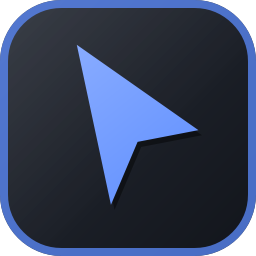
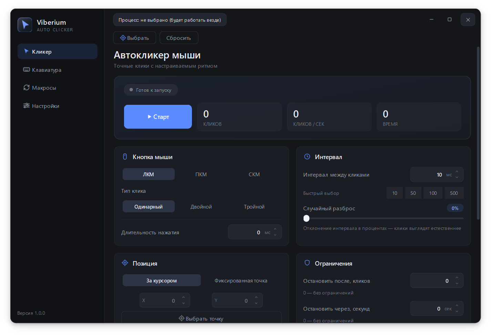
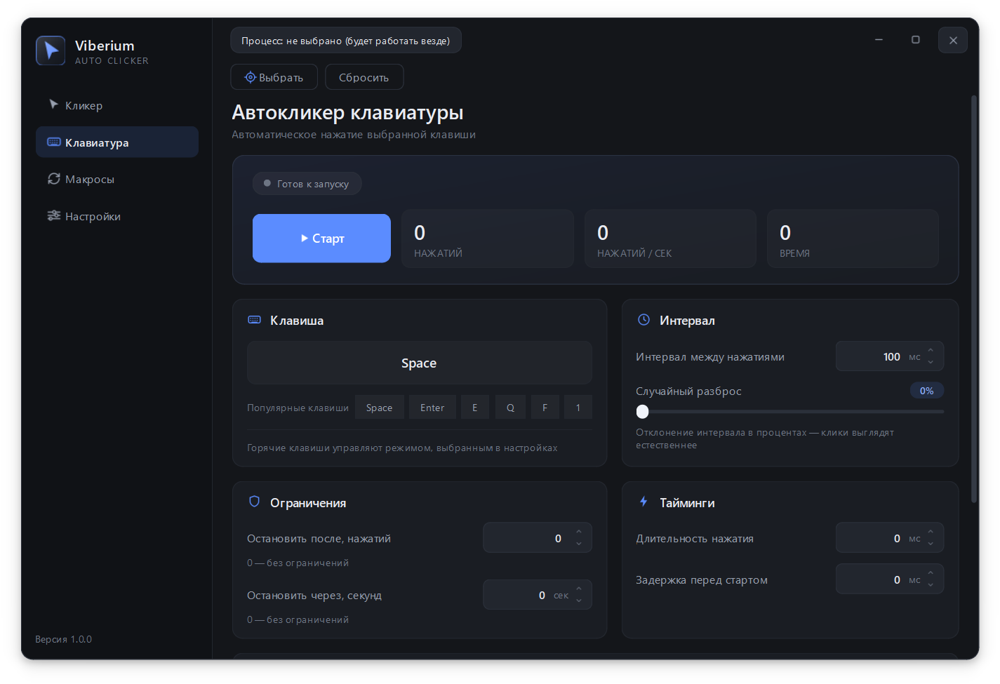
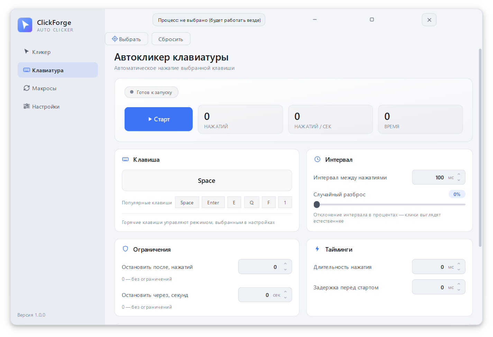
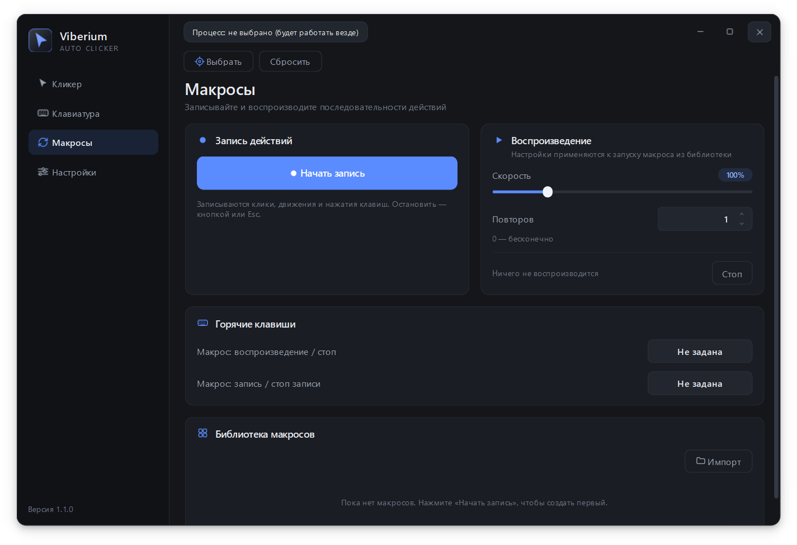
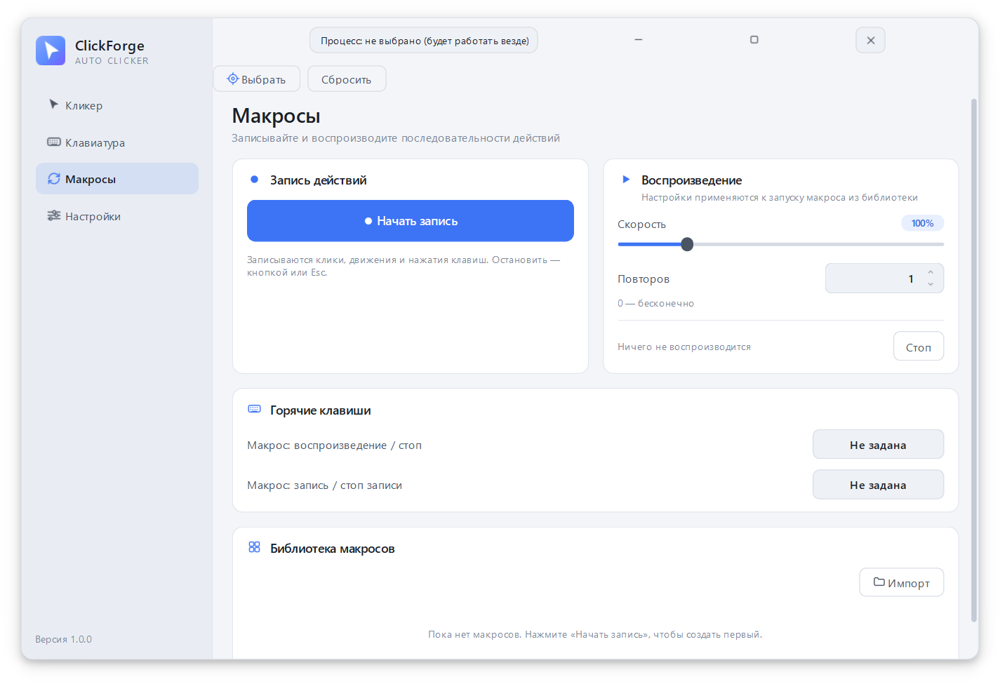
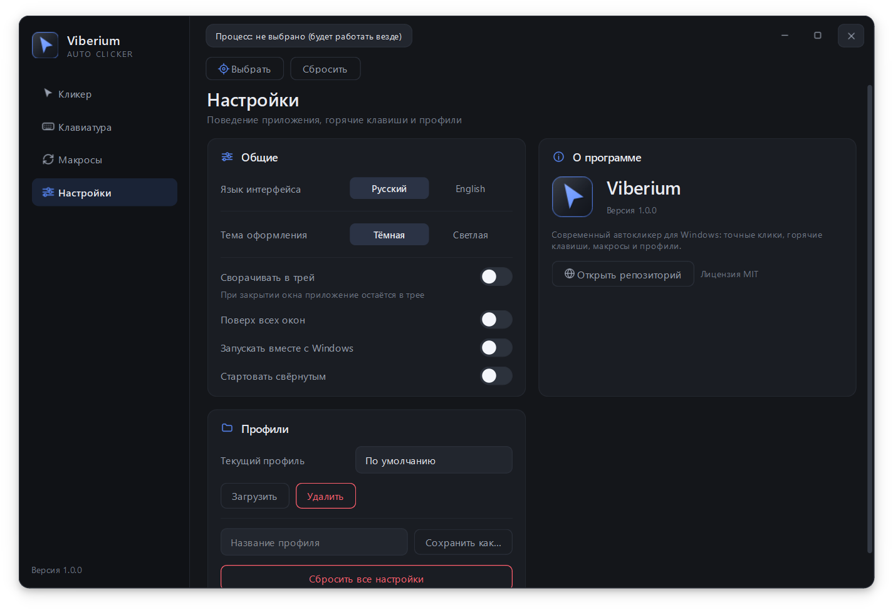
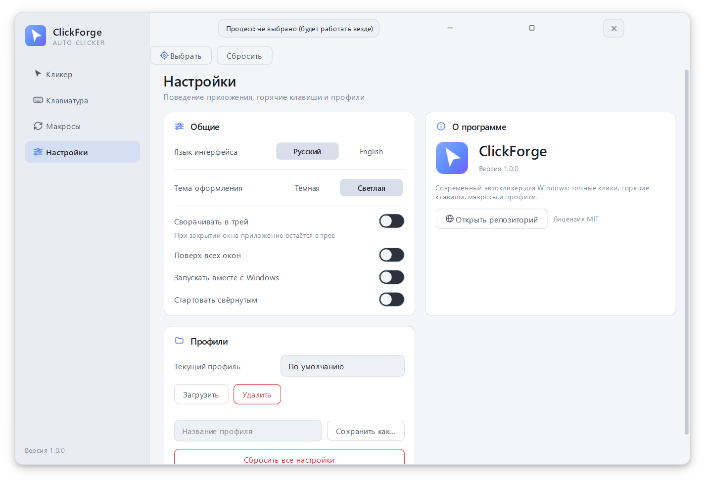

# Viberium

**Современный автокликер для Windows: тонкая настройка, макросы, горячие клавиши и две темы оформления.**

[Скачать](#скачать) · [Возможности](#возможности) · [Скриншоты](#скриншоты) · [English](README.en.md)

---

## О проекте

Viberium — автокликер для Windows с полностью кастомным интерфейсом. Он работает с системным вводом напрямую, поэтому клики и нажатия получаются точными и плавными — без задержек браузера и лишних посредников.

Внутри — всё, что нужно для рутинных действий: кликер мыши, кликер клавиатуры, запись макросов, глобальные горячие клавиши и работа только в выбранном окне. Интерфейс на русском и английском, тёмная и светлая темы.

Проект задуман как инструмент для **своих задач на своих устройствах**: повторяющиеся клики, тестирование интерфейсов, автоматизация рутины в программах. Пожалуйста, не используйте его для нарушения правил игр и сервисов.

## Возможности

<table>
<tr>
<td width="50%" valign="top">

### 🖱️ Автокликер мыши
- Кнопка: **ЛКМ / ПКМ / СКМ**
- Тип клика: одинарный, двойной, тройной
- Интервал в миллисекундах + быстрые пресеты
- Случайный разброс интервала (0–100 %)
- Длительность зажатия кнопки
- Позиция: за курсором или фиксированная точка
- Разброс позиции (jitter)
- Лимит по количеству кликов и по времени
- Остановка при движении мыши
- Задержка перед стартом

### ⌨️ Автокликер клавиатуры
- Захват любой клавиши
- Интервал, разброс, длительность нажатия
- Лимиты и задержка перед стартом

</td>
<td width="50%" valign="top">

### 🎬 Макросы
- Запись кликов, движения мыши и клавиш
- Воспроизведение со своей скоростью
- Повторы и библиотека макросов
- Импорт и экспорт в JSON

### ⌨️🔥 Горячие клавиши
- Отдельные комбинации для мыши, клавиатуры и макросов
- Старт/стоп, удержание для работы
- Экстренный стоп — **F8**
- Сочетания с Ctrl, Alt, Shift, Win
- Боковые кнопки мыши **X1 / X2**
- Сброс комбинации кнопкой **×**

### 🪟 Целевое окно
- Работа только в выбранном окне
- Если окно не активно — клики на паузе
- Если окно не выбрано — работа везде
- Процесс не сохраняется в профилях

### 🎨 Оболочка
- Тёмная и светлая темы
- Статистика: клики, CPS, время работы
- Трей, поверх всех окон, автозапуск
- Русский и английский языки
- Профили настроек

</td>
</tr>
</table>

## Скриншоты

| Тёмная тема | Светлая тема |
|:---:|:---:|
|  |  |
|  |  |
|  |  |

## Скачать

Готовые сборки лежат в разделе **[Releases](../../releases)**.

1. Скачайте `Viberium-windows.zip`.
2. Распакуйте архив **целиком** в любую папку.
3. Запустите `Viberium.exe`.

> **Важно:** `Viberium.exe` и папка `_internal` должны лежать рядом. Не вытаскивайте `.exe` из архива по отдельности — приложение не запустится.

Установка не требуется. Настройки хранятся в `%APPDATA%\Viberium`.

> **SmartScreen.** При первом запуске Windows может показать предупреждение о неизвестном издателе — это нормально для неподписанных приложений. Нажмите «Подробнее» → «Выполнить в любом случае». Антивирусы могут реагировать на глобальные хуки ввода.

## Системные требования

| | |
|---|---|
| ОС | Windows 10 / 11 (64-bit) |
| Свободное место | около 100 МБ |
| Дополнительные программы | не требуются |

## Горячие клавиши

По умолчанию назначен только экстренный стоп — **F8**. Остальные комбинации вы выбираете сами на страницах «Кликер», «Клавиатура» и «Макросы».

- Комбинации работают глобально, в том числе когда окно свёрнуто в трей.
- Поддерживаются Ctrl, Alt, Shift, Win и боковые кнопки мыши X1/X2.
- Повторное нажатие на поле захвата отменяет запись и очищает комбинацию; кнопка **×** делает то же самое.

## Лицензия

[MIT](LICENSE) © 2026 Viberium

## Предостережение

Программа предназначена для автоматизации своих задач на своих устройствах. Не используйте её для нарушения правил игр, сервисов или законодательства.
